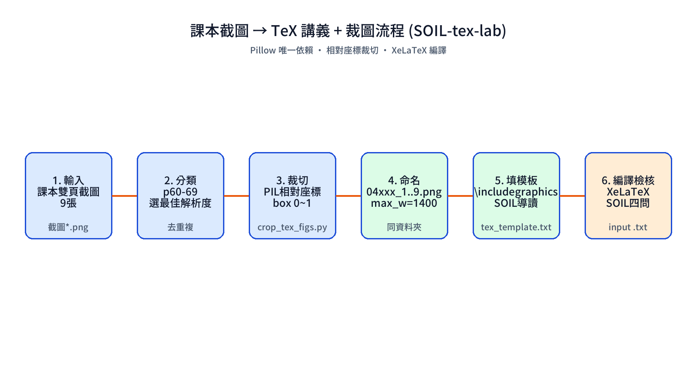

# SOIL-TeX-Lab｜課本截圖 → TeX 實驗講義 + 自動裁圖



## 1. 輸入規格（缺的先問）

1. 章節主題（例：CH4 超音波測距與倒車雷達）
2. 對象（預設：高中學生，K12 資訊科技）
3. 截圖資料夾（例：`115contant/04ultrosoundpic/`，內含雙頁截圖 `截圖*.png`）
4. 參考格式檔（例：`01esp32_01.txt, 02gryLED.txt, 03analogRead.txt`）
5. 輸出 txt 路徑（例：`115contant/04ultrosound.txt`）

## 2. 產出

- `<章節>.txt`：可被主 `.tex` 用 `\input{}` 直接編譯的片段，無 preamble
- `<前綴>_1..N.png`：裁切好的講義用圖，同資料夾，寬 ≤1400px
- SOIL 導讀 + 延伸檢核含在 txt 內

## 3. 流程（照做，不要跳步）

1. 讀參考 `01~03.txt`，鎖定格式：`{\Large \bf CH}` + 實驗名稱/日期/目的/材料/`itemize`/人員/座號 + `\includegraphics` + `tabular` + `\newpage` + `$公式$` + `\xleftrightarrow`。
2. 逐張讀截圖，按頁碼分類去重（選最大解析度那張，如 p62-63 有三份就選最清楚的）。
3. 寫 tex：修正舊稿誤植（如 CH4 後半誤貼 CH3 光敏電阻），補全公式 `距離=(時間/29.4)/2`、接線表、語法 `delayMicroseconds/pulseIn/tone`、四狀態分級、延伸題。
4. 裁圖：跑 `scripts/crop_tex_figs.py --src <截圖資料夾>`，用**相對座標** `box=[x0,y0,x1,y1]`，跨頁程式用上下拼接（01-30 在上、31-33 在下）。
5. 驗證：逐張讀裁切圖，檢查表格未被切掉（如 Trig/Echo 列）、程式碼順序正確、中文無亂碼；用 `ls -lh` 確認檔名與 txt 內 `\includegraphics` 一致。
6. TeX 跳脫：`#→\#`、`~→$\sim$`，程式碼盡量只放圖片內，正文只留一行範例，避免編譯失敗。

## 4. SOIL 模板（高中資訊科技版，直接貼進 txt）

```tex
{\bf 【SOIL導讀：這堂課要帶走什麼】}
總概念：xxx=一句話。\\
三個子概念：(1)xxx (2)xxx (3)xxx。\\
三個常見誤解：(1)xxx→正解xxx ...。\\
帶走一句話：xxx。
一、xxx(S-O) 二、xxx(O-I) 三、xxx(I-L) 四、延伸與檢核(L)
```

S=Selection 選取核心，O=Organization 組織結構，I=Integration 連結舊知，L=Learning 遷移應用。
李俊儀 SOIL 心法：先想清楚教什麼，再安排怎麼教，最後才處理呈現。

## 5. Python 套件（只用一個）

| 套件 | 功能 | 本 skill 用在哪 |
| --- | --- | --- |
| `Pillow (PIL)` | 開圖 `Image.open`、相對座標裁切 `crop`、等寬縮放 `resize(LANCZOS)`、上下拼接 `new/paste`、存 PNG `save` | `crop_tex_figs.py` 全流程；`assets/flow.png` 流程圖也是 PIL 畫的 |
| 標準庫 `argparse/json/os` | 參數 `--src/--jobs`、讀 jobs 設定、組路徑 | 同上腳本，無需安裝 |

安裝：`pip install pillow`（macOS 內建已有則免裝；本流程圖生成另用系統字型 `GenSekiGothic2TW-M.otf` 顯示中文，不需額外套件）。

> 不用 `matplotlib / opencv`：減少依賴，教室電腦 `pip install pillow` 即可跑。

## 6. 自訂裁切（新章節時改這裡）

```sh
python scripts/crop_tex_figs.py --src 115contant/05newpic
# 需微調時，先建 jobs.json 改 box，再：
python scripts/crop_tex_figs.py --src 115contant/05newpic --jobs jobs.json
```

box 量測法：先用大框 `0.04,0.07,0.98,0.97` 試切，看到目標後再收緊；表格類底部多留 5%，程式碼類頂部避開標題行。

## 7. 檢查清單

- [ ] txt 可被 `\input` 編譯（無 preamble、特殊字元已跳脫）
- [ ] 圖片檔名與 txt 內路徑一致
- [ ] 表格列未被切掉、程式碼順序由小到大
- [ ] SOIL 四段 S-O-I-L 都有對應節
- [ ] 引用註腳保留 `\footnote{尤濬哲(2021)...}`

## 參考

- 格式範例：`references/tex_template.txt`
- 實戰案例：CH4 超音波 `04ultrosound.txt` + `04ultrosound_1..9.png`
- 理論：李俊儀 SOIL（Selection / Organization / Integration / Learning）
